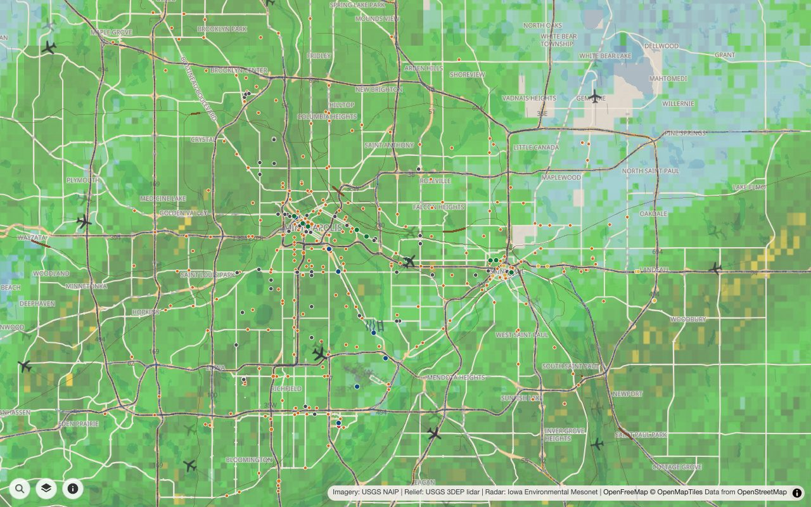
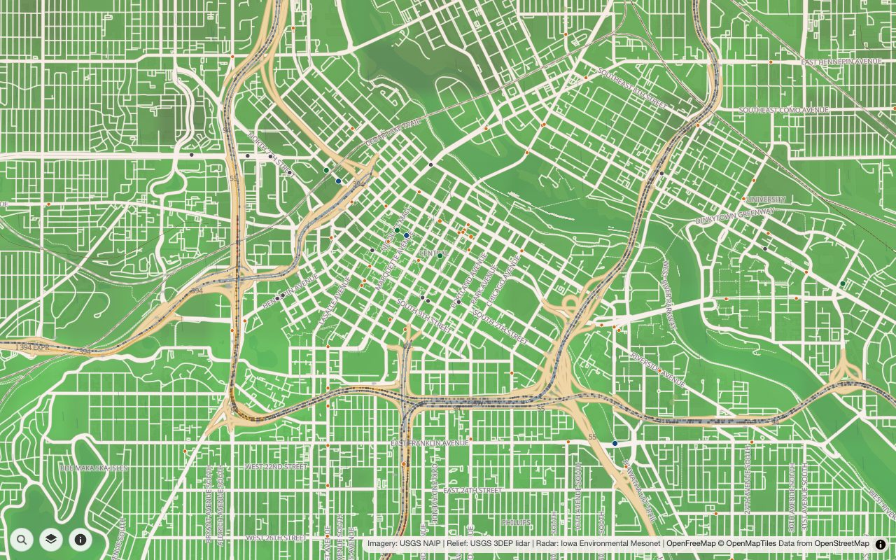
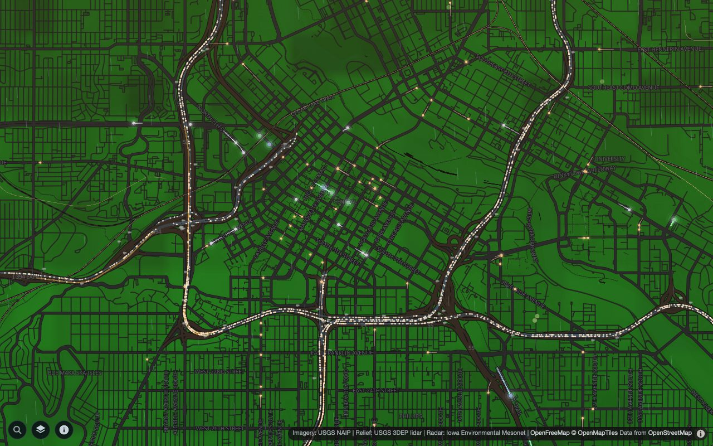
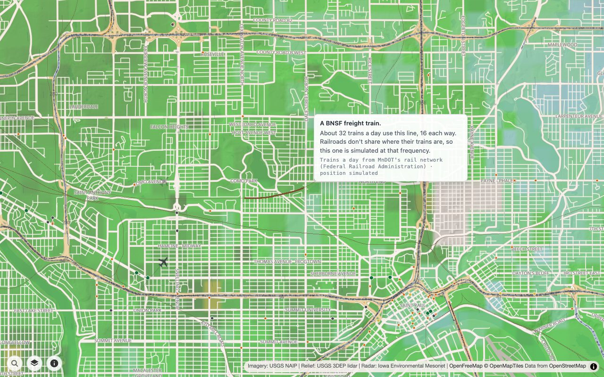
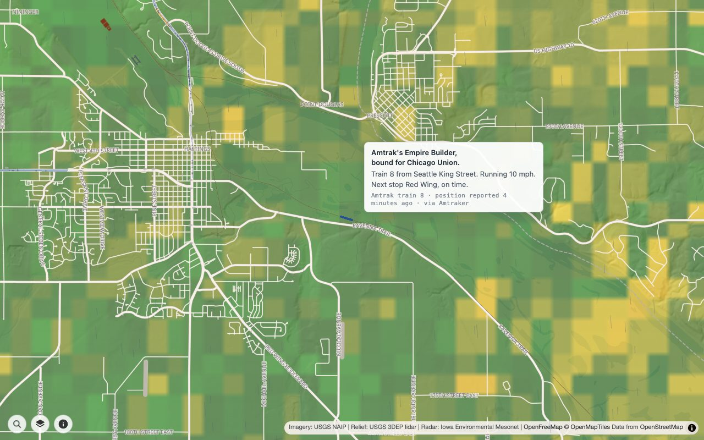
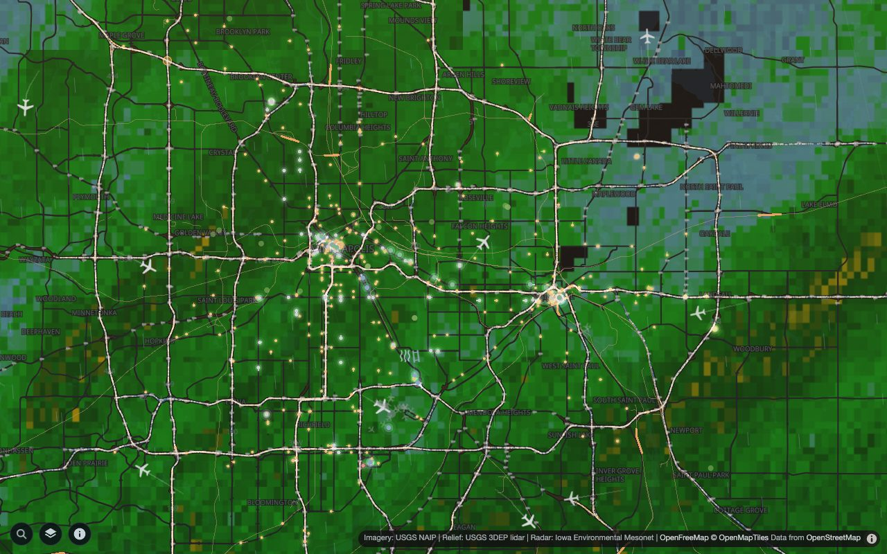

# Minneapolis From Above

**Live:** https://minneapolis-from-above.pages.dev

An ambient, top-down living map of Minneapolis–Saint Paul. Real buses and light rail trains glide along their actual routes in near real time, and so does a good deal else: freeway traffic, planes, satellites, freight and Amtrak trains, river boats, weather, wildlife and recent police activity. It is something to glance at and feel the pulse of the city, not a dashboard: no required interaction beyond pan and zoom. Hover or tap almost anything to see what it is.



| | |
| --- | --- |
|  |  |
|  |  |

The map follows the real sun, so it looks different at night:



## What's on the map

Every layer can be switched on and off from the layers panel (the stack icon at the left edge); the choice is remembered in the browser. Crime, shots fired and police drones start switched off; turn them on from the same panel.

| Layer | What you see | Real or modeled |
| --- | --- | --- |
| Buses & trains | Metro Transit and Duluth Transit vehicles on their routes | Live positions |
| Planes | Aircraft overhead, with flight details on hover | Live positions |
| Satellites & debris | Everything in orbit that is above the horizon | Computed from real orbits |
| Freeway traffic | Speed colors on every metro freeway, plus cars gliding along them | Real speeds and volumes; car positions made up |
| Freeway cameras, crashes & road work | Camera snapshots and live incidents | Live |
| Terrain relief | Bluffs, the river gorge and lake basins shaded from lidar elevation | Real (USGS 3DEP lidar) |
| Freight trains | Rust-colored trains on every active rail line | Real trains-a-day on each line; positions simulated |
| Amtrak | The Empire Builder (and any other Amtrak train in range) | Live positions, run forward between reports |
| River, locks & falls | Boats through the locks, St. Anthony Falls flow | Real lock logs and gauges |
| Weather watches & warnings, radar | NWS alerts, radar, clouds, wind, rain and snow | Live |
| Wildlife, fall color, northern lights | iNaturalist sightings, the DNR fall color report, aurora forecast | Live |
| Crime, shots fired, police drones (off until you switch them on) | Recent incidents from city open data, faded by age | Real, delayed or offset where privacy needs it |
| Game days, beaches, MSP status, snow emergencies | Venues in use, beach closures, airport delays, parking rules | Live |

## Where the numbers are real and where they are made up

Several layers show things that no one publishes the exact position of, so the map draws them at the real rate and says so in the hover card:

- **Freeway cars** are spawned at the volume and speed MnDOT's road sensors measure on each stretch.
- **Freight trains** run at the trains a day each railroad reports for the line (see `scripts/build-rail.mjs`). Railroads don't publish where trains are, so the positions are a simulation, and the hover card says so.
- **Amtrak** positions come from a community tracker that republishes Amtrak's own data, sometimes several minutes old, and are run forward at the reported speed between reports.

## Stack

- **Map:** [MapLibre GL JS](https://maplibre.org/) with free OpenStreetMap vector tiles from [OpenFreeMap](https://openfreemap.org/)
- **Moving layers:** [deck.gl](https://deck.gl/) rendered as an overlay on the map
- **Live data:** Metro Transit GTFS-realtime vehicle positions, decoded by a Cloudflare Pages Function at `/api/vehicles`
- **Route shapes:** Metro Transit static GTFS, baked into `public/data/` by `scripts/build-gtfs.mjs`
- **Hosting:** Cloudflare Pages (static frontend plus Functions)

## Privacy and security

No accounts, cookies, analytics or tracking, and nothing is kept on a visitor's device between visits; the details, including the three map hosts the browser talks to directly, are in [PRIVACY.md](PRIVACY.md). How the app is hardened (strict CSP, validated inputs, no open proxy, zero known vulnerable dependencies) is in [SECURITY.md](SECURITY.md). `node scripts/csp-check.mjs` checks the headers and reports any blocked request.

## Run it locally

```bash
npm install
npm run dev
```

Then open the URL Vite prints. The dev server also serves the `/api/*` endpoints using the same code that runs on Cloudflare.

The map follows the real sun over Minneapolis. To preview another time of day, add `?at=HH:MM` (Minneapolis time), for example `?at=13:00` for day, `?at=19:05` for the blue hour, or `?at=22:00` for night. Add `?weather=` with `snow`, `heavy-snow`, `rain`, `storm`, `fog`, `partly-cloudy`, `breezy`, `windy` or `calm` to preview weather.

You need Node 22.18 or newer (the tests and build scripts run TypeScript and modern JavaScript directly). No API keys are needed to run it locally.

## How it fits together

```
index.html, src/        The app: MapLibre base map, deck.gl overlay, one folder per kind of data
  main.ts               Wires every feed, layer and the hover card together; the render loop
  layers/               One deck.gl layer builder per data layer
  live/, traffic/, rail/, ...   Parsing, simulation and plain-language descriptions, one folder per topic
  toggles.ts            The layers panel entries (add a layer here to get a switch)
functions/api/          Cloudflare Pages Functions: one file is one /api/<name> endpoint
public/data/            Data baked at build time (routes, freeway layout, rail lines, ...)
scripts/                The scripts that bake public/data/ and take screenshots
test/                   Unit tests, one file per topic
docs/                   Screenshots and the guide to adding a layer
```

The pattern for a live layer is always the same: an endpoint in `functions/api/` fetches and boils down someone else's data (cached at the edge), a poller in `src/main.ts` fetches that endpoint, a `src/<topic>/` module turns it into things to draw and plain-language descriptions, a `src/layers/` builder draws them, and `src/hover.ts` makes them hoverable. [docs/adding-a-layer.md](docs/adding-a-layer.md) walks through it.

## Scripts

| Command | What it does |
| --- | --- |
| `npm run dev` | Local dev server with live data |
| `npm run build` | Typecheck and production build into `dist/` |
| `npm test` | Unit tests (Node's built-in test runner) |
| `npm run e2e` | End-to-end checks against the running dev server in headless Chrome |
| `npm run perf` | Frame rate at metro, downtown and street zoom in headless Chrome (real GPU) |
| `npm run shot -- <dir> <warmup> name:lon,lat,zoom` | Screenshots of the running app |
| `npm run shots` | Retake the README screenshots in `docs/screenshots/` |
| `npm run build:data` | Re-bake route data from Metro Transit's latest GTFS feed |
| `npm run build:freeways` | Re-bake the freeway sensor layout from MnDOT |
| `npm run build:rail` | Re-bake the railroad lines and trains-a-day from MnDOT |
| `npm run build:sats` | Snapshot every active satellite's orbit from CelesTrak (also runs on every deploy) |
| `npm run build:debris` | Snapshot the tracked space debris clouds from CelesTrak (also runs on every deploy) |
| `npm run build:ucs` | Re-bake satellite operators and purposes from the UCS database |
| `npm run preview` | Serve `dist/` plus Functions through Wrangler, as Cloudflare would |
| `npm run deploy` | Refresh the satellite and debris snapshots, build, and deploy to Cloudflare Pages (needs `wrangler login` once) |

`e2e`, `perf`, `shot` and `shots` drive your installed Google Chrome (set `CHROME` to use another path) and expect `npm run dev` to be running.

## License

The code in this repository is released under the [MIT License](LICENSE). The data it displays belongs to the sources below and is used under their own terms; the license does not cover it.

## Credits and data sources

Everything on the map comes from someone else's work. Thank you to:

**Base map and imagery**
- [OpenFreeMap](https://openfreemap.org/) vector tiles, built from [OpenStreetMap](https://www.openstreetmap.org/copyright) data (© OpenStreetMap contributors, ODbL)
- Aerial photography: [USGS National Agriculture Imagery Program](https://www.usgs.gov/centers/eros/science/usgs-eros-archive-aerial-photography-national-agriculture-imagery-program-naip), via The National Map
- Terrain relief: [USGS 3D Elevation Program](https://www.usgs.gov/3d-elevation-program) bare-earth lidar elevation, shaded by The National Map
- Weather radar: [Iowa Environmental Mesonet](https://mesonet.agron.iastate.edu/) (NEXRAD mosaic)

**Transit and roads**
- [Metro Transit](https://www.metrotransit.org/) GTFS and GTFS-realtime feeds
- [Duluth Transit Authority](https://duluthtransit.com/) GTFS and GTFS-realtime feeds
- [MnDOT](https://www.dot.state.mn.us/) freeway sensors and incidents (IRIS) and freeway cameras (via [CARS](https://public.carsprogram.org/))

**Sky and space**
- [CelesTrak](https://celestrak.org/) satellite orbits and catalog
- [Union of Concerned Scientists Satellite Database](https://www.ucsusa.org/resources/satellite-database) for satellite operators and purposes
- Aircraft positions from the community networks [adsb.lol](https://adsb.lol/) and [adsb.fi](https://adsb.fi/), and [The OpenSky Network](https://opensky-network.org/); flight routes from [adsbdb](https://www.adsbdb.com/)
- [NOAA Space Weather Prediction Center](https://www.swpc.noaa.gov/) geomagnetic forecast

**Weather and water**
- [National Weather Service](https://www.weather.gov/) observations, watches and warnings, and the [National Water Prediction Service](https://water.noaa.gov/) river gauges
- [Open-Meteo](https://open-meteo.com/) air quality
- [U.S. Army Corps of Engineers](https://ndc.ops.usace.army.mil/) lock logs for river traffic
- [Minnesota DNR](https://www.dnr.state.mn.us/) fall color report

**City and civic data**
- Recent crime: the open-data services of the cities of Minneapolis, Saint Paul, Duluth, Brooklyn Center, Maple Grove, Eagan, Bloomington, Brooklyn Park and Rosemount
- Gunfire calls (shots fired, ShotSpotter, shootings): the City of Minneapolis open-data service
- Police drone flights: the public drone-as-first-responder flight logs of the St. Paul, Brooklyn Park, Minnetonka, Duluth, St. Cloud and Rochester police departments (flight paths only, delayed and offset for privacy)
- Amtrak train positions: [Amtraker](https://amtraker.com/), a community service that republishes Amtrak's train tracking (unofficial; Amtrak has no public feed)
- Freight trains: [MnDOT](https://www.dot.state.mn.us/)'s Minnesota rail network (railroad lines and the trains a day each operator reported to the Federal Railroad Administration). The trains themselves are synthetic: real frequency, made-up positions
- Snow emergencies: the cities of Minneapolis and Saint Paul
- Beach status: Minneapolis Park Board
- Airport status: [FAA National Airspace System Status](https://nasstatus.faa.gov/)
- Live scores: MLB Stats API, NHL, and ESPN scoreboards
- Address and place search: the Metropolitan Council's metro geocoders, and [Photon](https://photon.komoot.io/) with OpenStreetMap data (© OpenStreetMap contributors)

**Wildlife**
- Observations and photos from [iNaturalist](https://www.inaturalist.org/); each photo is shown only when its own license allows reuse, and remains the work of its observer

**Libraries**
- [MapLibre GL JS](https://maplibre.org/) (BSD-3-Clause), [deck.gl](https://deck.gl/) (MIT), [satellite.js](https://github.com/shashwatak/satellite-js) (MIT), and [Vite](https://vite.dev/) (MIT)
- Hosted on [Cloudflare Pages](https://pages.cloudflare.com/)

This is an independent hobby project. It is not affiliated with or endorsed by any of the organizations above.

## Deploying

Cloudflare Pages hosts the static app and the functions together. Once, run `npx wrangler login`; after that `npm run deploy` refreshes the satellite snapshots, builds, and publishes to the `minneapolis-from-above` Pages project (see `wrangler.toml`). There are no secrets or environment variables to set.

## Backlog

Work is done story by story, with one commit per completed story.
